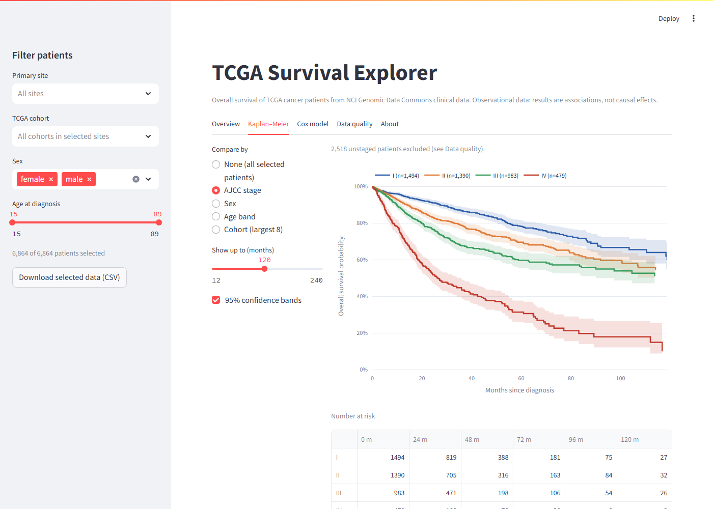
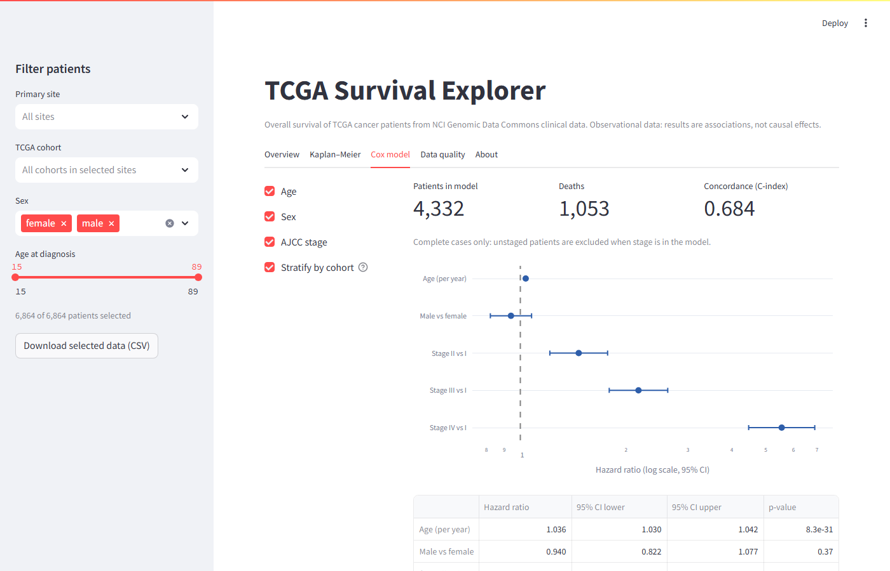

# TCGA Survival Analysis

Overall survival in **6,864** cancer patients across 32 TCGA cohorts, modelled in R (Kaplan–Meier, Cox
regression stratified by cancer type, logistic regression) and turned into an interactive Streamlit app that
reproduces the R results.



## Key results

- **6,864** patients with usable follow-up and **2,047** deaths; median overall survival **88.1 months**
  (95% CI 82.8–96.7).
- Survival separates in stage order (log-rank χ² = **424** on 3 df, p < 2e-16). Median survival falls from
  173.7 months at stage I to **26.5 months** at stage IV.
- Cox model stratified by cancer type: n = **4,332** patients and **1,053** deaths in the 22 cohorts with
  AJCC staging.
  - Stage IV vs stage I: hazard ratio **5.56** (95% CI 4.47–6.90).
  - Age: hazard ratio **1.036** per year, so each year of age adds about 3.6% to the hazard.
  - Sex: no significant effect (male vs female 0.94, 95% CI 0.82–1.08).
  - Concordance **0.684**. Proportional-hazards global test p = **0.25**, so no evidence the assumption fails.
- Negative result: age and sex are statistically significant predictors of advanced stage (III–IV) but cannot
  usefully predict it. Mean predicted risk across deciles spans only **0.25–0.42**, and observed rates do not
  rise steadily with it.
- The Python app reproduces all **12** key R results (`app/check_against_r.py`).



## How to run

### R analysis

The rendered notebook is [`R/survival_analysis.html`](R/survival_analysis.html). To re-run it:

1. Install the packages:
   `install.packages(c("readr","dplyr","stringr","ggplot2","survival","survminer","broom"))`.
2. Download `annotation712_update.json` from the
   [HistGen dataset](https://huggingface.co/datasets/david4real/HistGen) (free; sign in and accept the terms),
   then rebuild the clinical metadata from the GDC API:
   `python R/fetch_metadata.py path/to/annotation712_update.json`.
3. Knit `R/survival_analysis.Rmd`.

GDC has changed its clinical data model since the extract behind the rendered notebook, so a fresh run gives
somewhat different numbers. See [`R/README.md`](R/README.md).

### Python app

The analysis data are included, so the app runs straight away:

```bash
pip install -r app/requirements.txt
python app/check_against_r.py   # optional: reproduces the R results
streamlit run app/app.py
```

## Data

Open-access clinical data from The Cancer Genome Atlas (TCGA), retrieved through the
[NCI Genomic Data Commons](https://portal.gdc.cancer.gov) API. The cohort is the 7,690 TCGA diagnostic slides
in the HistGen dataset (one per patient); 6,864 of those patients have a usable survival time.
`app/data/tcga_survival.csv` holds only derived, de-identified fields: cohort, primary site, survival time and
status, stage, sex and age. The raw metadata written by `R/fetch_metadata.py` contains GDC case identifiers and
is not committed.

*The results shown here are in whole or part based upon data generated by the TCGA Research Network:
https://www.cancer.gov/tcga.*

## Project structure

```
R/
  survival_analysis.Rmd    notebook source
  survival_analysis.html   rendered notebook
  fetch_metadata.py        rebuilds the clinical metadata from the GDC API
app/
  app.py                   Streamlit interface (Plotly charts)
  survival.py              Kaplan–Meier, log-rank, stratified Cox (Efron ties), concordance
  check_against_r.py       checks the app's statistics against the R output
  prepare_data.py          builds data/tcga_survival.csv with the notebook's cleaning rules
  data/tcga_survival.csv   one row per patient, no identifiers
docs/                      app screenshots
```

## Limitations

- Observational repository data, not trial data: no randomisation, sparse treatment information and follow-up
  that varies between cohorts. All estimates are associations, not causal effects.
- AJCC staging is missing by design for several tumour types (for example brain, gynaecological and prostate
  cancers), so the stage-adjusted models cover 22 of the 32 cohorts.
- Stage is collapsed from the AJCC sub-stages to I–IV, which discards detail within each group.
- The rendered results come from an earlier GDC extract. A fresh download differs, partly because GDC has
  restructured its clinical fields (see [`R/README.md`](R/README.md)).

## Licence

MIT. See [LICENSE](LICENSE).
