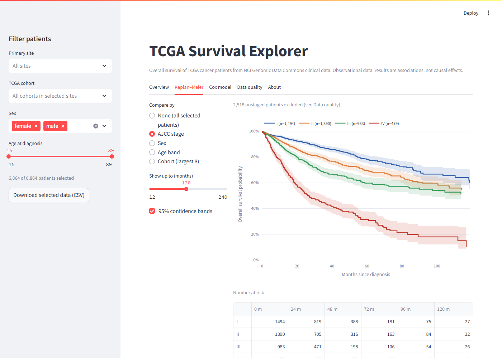

# TCGA Survival Explorer

An interactive Streamlit app for exploring overall survival in 6,864 cancer patients from The Cancer Genome
Atlas (TCGA), using open-access clinical data from the NIH/NCI Genomic Data Commons (GDC).

It turns my R survival analysis ([`../R`](../R)) into a tool that a non-programmer can use. Filter by
primary site, cohort, sex and age, and the survival curves, tests and models update.



## What it shows

| Tab | Contents |
|---|---|
| Overview | Patients, deaths, median overall survival and follow-up; per-cohort table with the share of patients staged |
| Kaplan–Meier | Survival curves with 95% confidence bands, grouped by stage, sex, age band or cohort; number-at-risk table; log-rank test; median survival per group |
| Cox model | Cox proportional-hazards regression (age, sex, stage; optionally stratified by cohort) with a forest plot, hazard ratios, 95% CIs, p-values and concordance |
| Data quality | Which cohorts have AJCC staging (missing by design for, e.g., brain tumours) and the follow-up distribution |
| About | Data source, methods, validation and caveats |

The current selection can be downloaded as CSV.

## Validation against R

`check_against_r.py` recomputes the key results on the full dataset and compares them with the R notebook's
output (`survival`/`coxph`). All twelve checks match:

| Quantity | R | App |
|---|---|---|
| Patients / deaths | 6,864 / 2,047 | 6,864 / 2,047 |
| Median overall survival | 88.1 months | 88.1 months |
| Log-rank χ² across stages | 424 (3 df) | 424 (3 df) |
| Cox model n / events | 4,332 / 1,053 | 4,332 / 1,053 |
| Hazard ratio, stage IV vs I | 5.5563 | 5.5563 |
| Concordance | 0.684 | 0.684 |

## Run it

From the repository root:

```bash
pip install -r app/requirements.txt
python app/check_against_r.py      # optional: confirm the statistics
streamlit run app/app.py
```

`data/tcga_survival.csv` is already included. To rebuild it from the GDC metadata, first create
`R/data/metadata.csv` with `R/fetch_metadata.py` (see [`../R/README.md`](../R/README.md)), then run
`python app/prepare_data.py`. A fresh GDC download differs from the extract behind the included file, so
`check_against_r.py` will then report mismatches.

## Files

| File | Purpose |
|---|---|
| `prepare_data.py` | Cleans the GDC extract with the same rules as the R notebook: missing-value tokens, one row per patient, event and time definitions, stage I–IV |
| `survival.py` | Kaplan–Meier, log-rank, stratified Cox (Efron ties) and concordance, using statsmodels |
| `app.py` | The Streamlit interface (Plotly charts) |
| `check_against_r.py` | Reproduces the R results |

## Caveats

Observational repository data, not trial data: no randomisation, sparse treatment information, and follow-up
that varies between cohorts. All estimates are associational. AJCC staging is missing by design for several
tumour types, so analyses that include stage are restricted to staged cohorts.

## Data and acknowledgement

The data are from TCGA via the NCI Genomic Data Commons (https://portal.gdc.cancer.gov), open access. The
included file holds only derived, de-identified fields: cohort, primary site, survival time and status, stage,
sex and age. *The results shown here are in whole or part based upon data generated by the TCGA Research
Network: https://www.cancer.gov/tcga.*

Developed with AI coding assistance (Claude), starting from my own R analysis and data preparation. Results are
validated against the original R analysis (see above).
